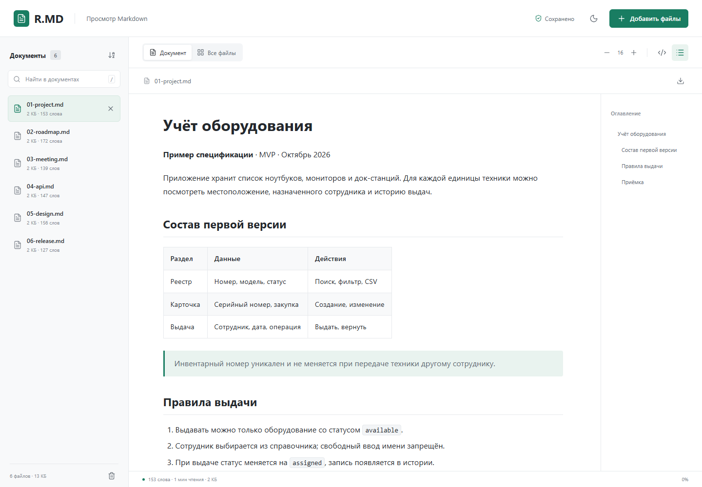
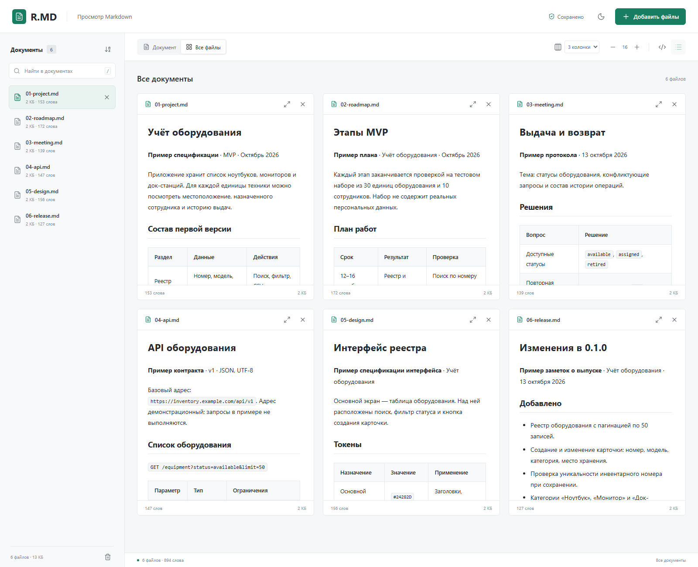
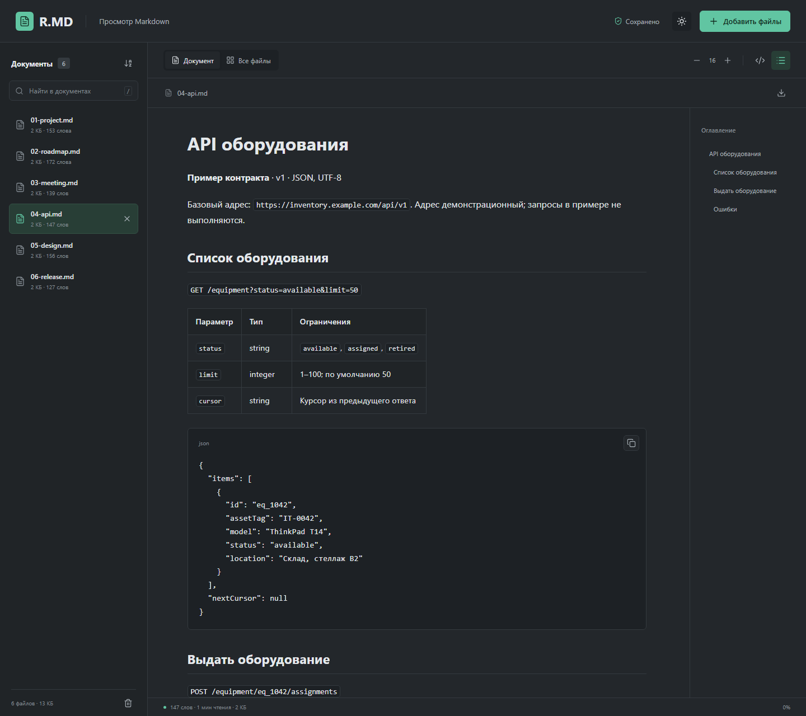

# R.MD

Просмотрщик Markdown в одном HTML-файле. Открывает несколько документов, сохраняет их в браузере и восстанавливает после перезагрузки.



## Использование

Откройте [`index.html`](index.html) и добавьте `.md`-файлы через кнопку или перетаскиванием. Можно выбрать все 20 сразу. Установка и интернет не нужны.

- Чтение одного документа с оглавлением или сетка в 1–3 колонки.
- Поиск по имени и содержимому, сортировка, переходы между открытыми Markdown-файлами.
- Светлая и тёмная темы, размер текста, просмотр исходника, копирование кода.
- Таблицы, списки задач и адаптивный интерфейс.

Форматы: `.md`, `.markdown`, `.mdown`, `.mkd`, `.mkdn`. Лимит — **20 МБ на файл**. В [`examples/`](examples) лежат шесть связанных документов учебного проекта; они использованы на скриншотах.



## Хранение данных

Документы и состояние просмотра сохраняются в **IndexedDB**. Статус в шапке показывает результат сохранения. Закрытие файла удаляет его из библиотеки, корзина очищает библиотеку целиком; удаление можно сразу отменить кнопкой **«Вернуть»**. Исходные файлы на диске не меняются.

Данные доступны в том же браузере, профиле и по тому же адресу страницы. Локальный HTML и GitHub Pages используют отдельные хранилища. Очистка данных сайта удалит библиотеку; приватный режим и настройки браузера могут ограничить сохранение. Для `file://` поведение зависит от браузера, а перемещение HTML может изменить доступ к данным. Храните оригинальные `.md` отдельно.

Приложение не отправляет текст документов на сервер. Внешние изображения из Markdown загружаются по указанным адресам. Локальные изображения и другие вложения автоматически не импортируются.



## Разработка

Нужен Node.js 22+. Правки вносите в `src/`; `index.html` собирается из исходников и библиотек в `vendor/`.

```sh
npm ci
npx playwright install chromium
npm run build
npm test
npm run screenshots
```

Тесты запускаются в Chromium. Скрипт скриншотов загружает `examples/` и обновляет три PNG в `docs/screenshots/`. Переменная `CHROMIUM_PATH` позволяет использовать установленный Chromium.

`npm run serve` запускает [локальный сервер](http://127.0.0.1:4173). Другой порт: `npm run serve -- --port=4174`.

## GitHub Pages

Создайте пустой публичный репозиторий без README, лицензии и `.gitignore`. В папке проекта выполните команды, заменив `YOUR_NAME` и `YOUR_REPOSITORY`:

```sh
git init -b main
git add .
git commit -m "Initial release"
git remote add origin https://github.com/YOUR_NAME/YOUR_REPOSITORY.git
git push -u origin main
```

1. В **Settings → Pages → Build and deployment → Source** выберите **GitHub Actions**.
2. В **Actions → Deploy GitHub Pages** запустите **Run workflow** для `main`. Если первый запуск упал до включения Pages, нажмите **Re-run all jobs**.
3. Ссылка на сайт появится в **Settings → Pages** и в результате workflow. Следующие push в `main` публикуются автоматически.

Workflow проверяет приложение и публикует только `index.html` и `.nojekyll`. Загруженные пользователем документы не попадают в репозиторий или на GitHub Pages.
